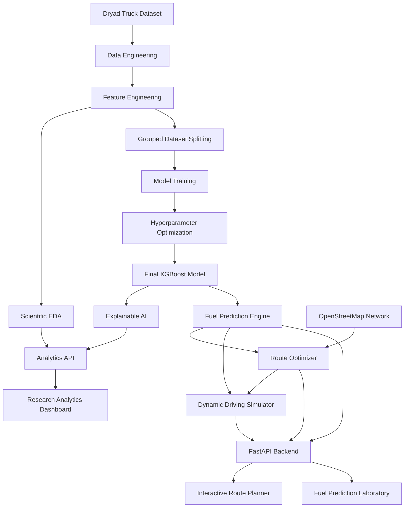

# EcoRoute AI — System Architecture

## Architecture Diagram

## Architecture Components

- Data Layer: Dataset ingestion and validation
- Intelligence Layer: Machine learning and explainability
- Geospatial Layer: Road network and route optimization
- Simulation Layer: Dynamic driving profile generation
- Service Layer: FastAPI REST endpoints
- Presentation Layer: Interactive web dashboards
- Quality Layer: Automated system integration tests
